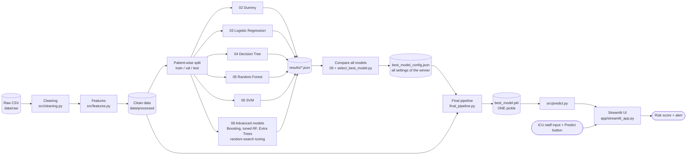

<div align="center">

# 🩺 Early Prediction and Risk Stratification of Sepsis in ICU Patients

**Machine Learning · Healthcare AI · Sukkur IBA University, Department of Computer Science**

</div>

Predicts sepsis in ICU patients up to **6 hours before** clinical diagnosis from hourly vitals and labs.
Includes data cleaning, EDA, 8 models (5 original + 3 tuned advanced, XGBoost / LightGBM optional), automatic best-model selection, and a **Streamlit** web app.

---
## Live Demo 

**Streamlit app (deployed by Muhammad Usman):**   [Open the live app](https://sepsis-icu-early-prediction.streamlit.app/)

---

## 👥 Team and Roles

| Member | CMS ID | Role in proposal | What was done in this project |
|---|---|---|---|
| **Muhammad Mubashir Shafique** (Team Lead) | 024-24-0235 | Data Preprocessing, EDA, Baseline Modeling | Cleaning (`src/cleaning.py`), features (`src/features.py`), EDA notebook `01`, Dummy notebook `02`, Logistic Regression notebook `03` |
| **Ghulam Mustafa** | 023-24-0212 | Model Development and Tuning | Decision Tree `04`, Random Forest `05`, SVM `06`, model settings (`src/pipeline.py`), **advanced models and hyperparameter tuning** (`src/advanced_models.py`, notebook `08`) |
| **Muhammad Usman** | 023-24-0221 | Evaluation, Streamlit GUI, Report | Metrics and plots (`src/evaluation.py`), comparison notebooks `07` and `09`, best-model selection and settings file (`src/select_best_model.py`), final pipeline and pickle (`src/final_pipeline.py`), Streamlit app (`app/`), report and docs |

---


##  System Architecture



---

##  Dataset

- PhysioNet / Computing in Cardiology Challenge 2019 (Kaggle, MIT license)
- 546,122 hourly rows, 14,057 ICU patients, 44 columns (vitals, labs, age, gender, ICU stay)
- Target `SepsisLabel`: only **2.2%** of rows are sepsis (very imbalanced)
- Label is already shifted 6 hours before diagnosis, so the model gives early warning

##  What we did to the data

| Step | Action |
|---|---|
| Broken row | 1 half-empty last row removed |
| Duplicates | Exact and repeated patient-hour rows removed |
| Sparse columns | 10 columns with over 95% missing dropped (EtCO2, TroponinI, ...) |
| Feature selection | Only **12 key sepsis signs** kept (see below) |
| Wrong values | Values outside human range set to missing (example: FiO2 above 1) |
| Missing values | Last known value per patient (forward fill), then train-median in the model pipeline |
| New feature | `ShockIndex` = HR / SBP |
| Split | 70 / 15 / 15 by **patient** (no patient in two sets, no leakage) |

**Final 13 features:** HR, Resp, Temp, SBP, MAP, O2Sat (vitals) · Lactate, WBC, Creatinine, Platelets (labs) · Age, ICULOS (patient) · ShockIndex (new).
They match the SIRS / qSOFA / SOFA sepsis criteria and were top in model feature importance.

##  Results (test set)

| Model | ROC-AUC | PR-AUC | Recall | Precision | F2 |
|---|---|---|---|---|---|
| Dummy (baseline) | 0.500 | 0.020 | 0.00 | 0.00 | 0.000 |
| Logistic Regression | 0.721 | 0.094 | 0.35 | 0.11 | 0.243 |
| Decision Tree | 0.735 | 0.083 | 0.36 | 0.15 | 0.278 |
| Random Forest (original) | 0.783 | 0.102 | 0.39 | 0.14 | 0.287 |
| SVM (RBF) | 0.755 | 0.079 | 0.38 | 0.09 | 0.231 |
| Random Forest (tuned, wider search) | 0.780 | 0.103 | 0.42 | 0.12 | 0.279 |
| Extra Trees (tuned) | 0.781 | 0.104 | 0.35 | 0.16 | 0.283 |
| **Histogram Gradient Boosting (tuned) ✅ best** | **0.785** | **0.104** | **0.42** | 0.13 | **0.289** |

- **Best model rule:** highest average of validation ROC-AUC, PR-AUC and F2 (test set not used to choose). Boosting scored 0.3875, the old Random Forest 0.3774, so **boosting replaced Random Forest**.
- **Two alert modes** (both thresholds are tuned on validation):

| Mode | Recall | Precision | Specificity | Use |
|---|---|---|---|---|
| Balanced (F2 threshold 0.668) | 0.42 | 0.13 | 0.94 | normal use |
| High sensitivity (threshold 0.395) | **0.73** | 0.05 | 0.70 | when a missed case is unacceptable, accepts many false alarms |

- Scores are modest because sepsis is rare (2%) and the app scores **one time point** only. Treat it as a screening aid.
- `ICULOS` (hours in ICU) is the strongest feature in this dataset, so a long ICU stay raises the score.
- XGBoost and LightGBM are supported by the code but have no results yet (they need `pip install xgboost lightgbm`, then re-run notebooks `08` and `09`).
- Winner settings (max_iter 300, learning_rate 0.02, max_depth 6, max_leaf_nodes 15, min_samples_leaf 100, l2 10, balanced class weight) are saved in `models/best_model_config.json`.
- Next real improvement: history features (trends over the last hours), not another algorithm.

## 📁 Folder Structure

```
Sepsis_ICU_Prediction/
├── data/
│   ├── raw/Dataset.csv            # original data
│   └── processed/clean_data.parquet
├── src/                           # reusable python code
│   ├── config.py  cleaning.py  features.py
│   ├── pipeline.py                # original 5 models
│   ├── advanced_models.py         # boosting, tuned RF, Extra Trees + random-search tuning
│   ├── evaluation.py
│   ├── select_best_model.py       # compare models -> best_model_config.json
│   ├── final_pipeline.py          # train ONLY the best model -> best_model.pkl
│   └── predict.py
├── notebooks/                     # one notebook per model (already executed)
│   ├── 01_Preprocessing_EDA.ipynb
│   ├── 02_Dummy_Classifier.ipynb
│   ├── 03_Logistic_Regression.ipynb
│   ├── 04_Decision_Tree.ipynb
│   ├── 05_Random_Forest.ipynb
│   ├── 06_SVM.ipynb
│   ├── 07_Model_Comparison.ipynb  # original 5-model comparison
│   ├── 08_Advanced_Models_Tuning.ipynb
│   └── 09_Final_Comparison.ipynb  # all models, selection, final pickle
├── models/
│   ├── best_model_config.json     # all settings of the chosen model
│   └── best_model.pkl             # the only pickle (final model)
├── results/                       # metrics, comparison.csv, figures/
├── app/streamlit_app.py           # web UI (+ assets/sepsis.png)
├── Documentation/                 # one readme per project part
├── train_all.py  requirements.txt  PROGRESS.md
└── README.md
```

##  How to Run

```bash
pip install -r requirements.txt

# 1. (optional) re-run everything: cleaning, notebooks 02-06 and 08, best model, final pickle
#    (about 35 minutes). Install xgboost and lightgbm first to include them.
python train_all.py

# 2. start the web app
streamlit run app/streamlit_app.py
```

Only want the app? Step 2 is enough. `models/best_model.pkl` is already included (saved with the scikit-learn version stored in `best_model_config.json`; if loading fails, run `python -m src.final_pipeline`).

##  Streamlit App

- Modern glass-style UI with the project logo
- Only 12 inputs: 6 vitals, 4 labs, age, hours in ICU
- **Alert mode:** Balanced or High sensitivity (recall about 73%, more false alarms)
- **Prediction runs only when you press "Predict sepsis risk"** (changing a value does nothing until then)
- Result: risk gauge, risk level (Low / Elevated / High), alert message, warning-sign chips
- Quick **Healthy / Sepsis-like** example buttons and a model performance tab with all models, the high-sensitivity table and feature importance


---

##  Documentation

|  Documentation / - one readme for each project part |
|---|
| [00 Overview](Documentation/00_Overview.md) |
| [01 Data Cleaning](Documentation/01_Data_Cleaning.md) |
| [02 EDA](Documentation/02_EDA.md) |
| [03 Feature Engineering](Documentation/03_Feature_Engineering.md) |
| [04 Baseline Models (Dummy, Logistic Regression)](Documentation/04_Baseline_Models.md) |
| [05 Decision Tree and Random Forest](Documentation/05_Tree_Models.md) |
| [06 SVM](Documentation/06_SVM.md) |
| [07 Evaluation and Model Selection](Documentation/07_Evaluation_and_Selection.md) |
| [08 Best Model Settings and Pickle](Documentation/08_Pickle_Model.md) |
| [09 Streamlit UI](Documentation/09_Streamlit_UI.md) |
| [10 Advanced Models and Tuning](Documentation/10_Advanced_Models.md) |

---

## ⚠️ Disclaimer

University project. Not a medical device. Not for real patient care.
